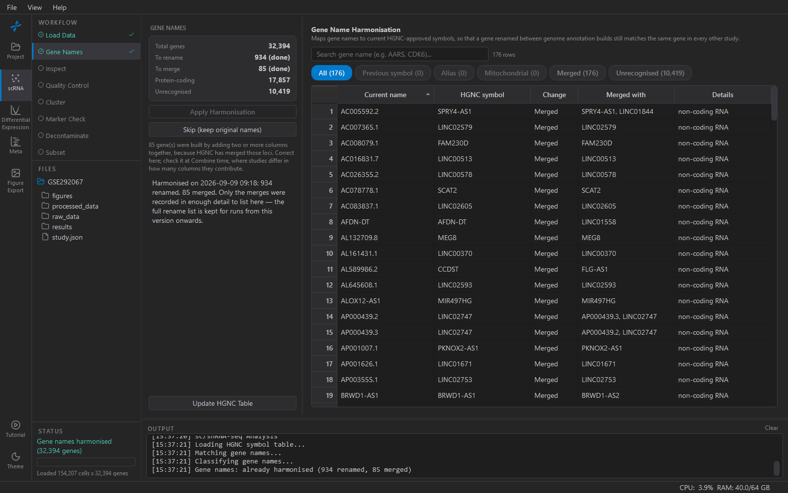

# Gene Names

Renames the dataset's genes to their current official symbols: the
**HGNC**-approved symbols for human data, and the **MGI** symbols for
mouse data. Nothing else in KOSMIC needs this for one study; the
meta-analysis needs it absolutely.

## Why

Two studies deposited three years apart used different genome
annotations, and the same gene has different names in each — `FAM19A5`
in one, `TAFA5` in the other; `C10orf54` and `VSIR`; `MLLT4` and
`AFDN`. Meta-analysis matches genes across studies *by name*, so a gene
that has not been renamed to the current symbol drops out of the
pooled result.
The shared-gene count on the Project page's Shared Atlas step shows how
much this costs: a study on an older build can share barely two thirds
of its genes with the others until it is harmonised.

For human data the renaming uses HGNC's own tables, which record for
every current symbol the *previous symbols* it replaced and the
*aliases* it is known by. For mouse data it uses MGI's marker list,
which records for every current gene its *synonyms*, including its
earlier symbols (`Pih1d3` is now `Dnaaf6rt`, `Ccdc115` is now `Vma22`).

## Which table

KOSMIC chooses the table from the gene names themselves: human symbols
are upper case (`MYH7`), mouse symbols are mixed case (`Myh7`). The
description at the top of the step says which was detected. The two
tables are never mixed: matched against the human table, a mouse gene
would be renamed to an unrelated human gene wherever its upper-case
form is an HGNC alias (`Hc` would become `CLTC`).

## What the run proposes

Open the step and KOSMIC scans the dataset against the table and shows
what it would change, without changing anything yet. The sidebar
summarises:

| Row | Meaning |
|---|---|
| Total genes | genes in the dataset |
| To rename | genes whose name would change |
| To merge | current symbols that two or more old names map to — their counts are added together |
| Protein-coding | how many genes the table classes as protein-coding, *after* the run |
| Unrecognised | names the table has never heard of, *after* the run |

The table lists every proposed change with its reason. Filter it with
the chips:

- **Previous symbol** (human) — HGNC's most authoritative mapping: the
  old name was formally retired in favour of the new one. Safe.
- **Alias** (human) — a looser mapping. Worth reading before you accept.
- **Synonym** (mouse) — a name MGI lists for the gene. MGI does not say
  whether it is an earlier symbol or an alias, so all mouse renames
  carry this one reason. Most are `Gm…` and `…Rik` placeholder names
  that have since been given a proper symbol.
- **Mitochondrial** — legacy mtDNA names (`ND1`, `CYTB`, `COX1`) mapped
  explicitly to `MT-ND1`, `MT-CYB`, `MT-CO1`. These are handled
  separately because several collide with unrelated nuclear genes in
  the HGNC alias table — `ND1` is also an alias of `IVNS1ABP` — and in
  single-cell data they are always the mitochondrial gene.
- **Merged** — columns whose counts are summed because the table has
  merged the loci. Usually a handful.
- **Unrecognised** — retired clone-based names, bare Ensembl IDs.
  Nothing is renamed; they are listed because they match nothing in
  another study either.

## The ambiguity rule

An old name that two current genes both claim is **never renamed**.
Remapping it would silently move counts to the wrong gene. This is why
some obvious-looking renames are absent from the list; they are
ambiguous in HGNC or MGI, and KOSMIC leaves them alone rather than
guess. A name that is itself a current symbol is never renamed either.

## Apply, or skip

**Apply Harmonisation** renames in place, sums merged columns, and
saves the h5ad. The change is recorded in the study's provenance, so
Methods will say it was done, how many genes it touched, and which
release of the table was used (for MGI, the date the report was
downloaded). Harmonise every study in a project with the same release:
a gene renamed after a table was built is not renamed by it, so studies
harmonised with different releases can still disagree.

**Skip (keep original names)** marks the step done without changing
anything. Do this only if every study in the project is already on the
same annotation build — otherwise you are choosing a smaller
meta-analysis.

**Update HGNC Table** (human data only) downloads the current table
from genenames.org. The bundled one is fine for most work; update it if
a study is newer than KOSMIC's copy. The bundled MGI table is rebuilt
from MGI's `MRK_List2.rpt` by `dev/scripts/build_mgi_symbols.py`.

## Other species

Only human and mouse are supported. Data from another species is
treated as one of the two by the case of its gene names, so skip this
step for it.
